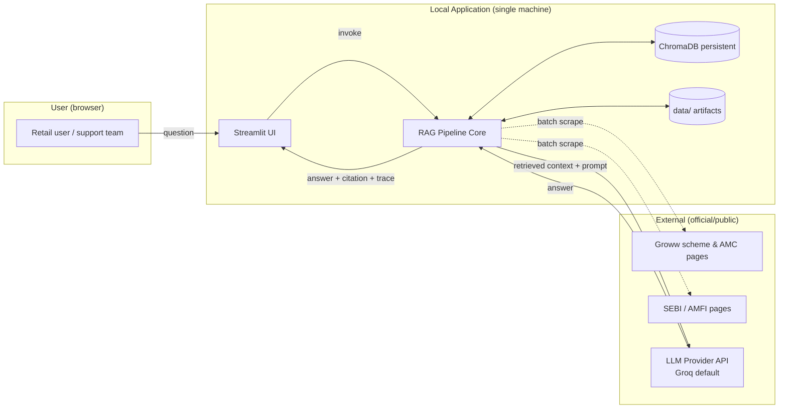
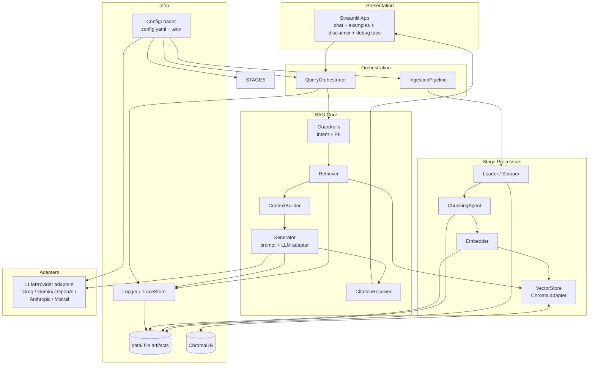
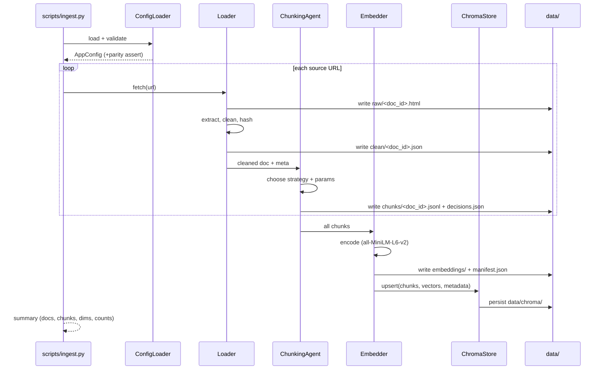
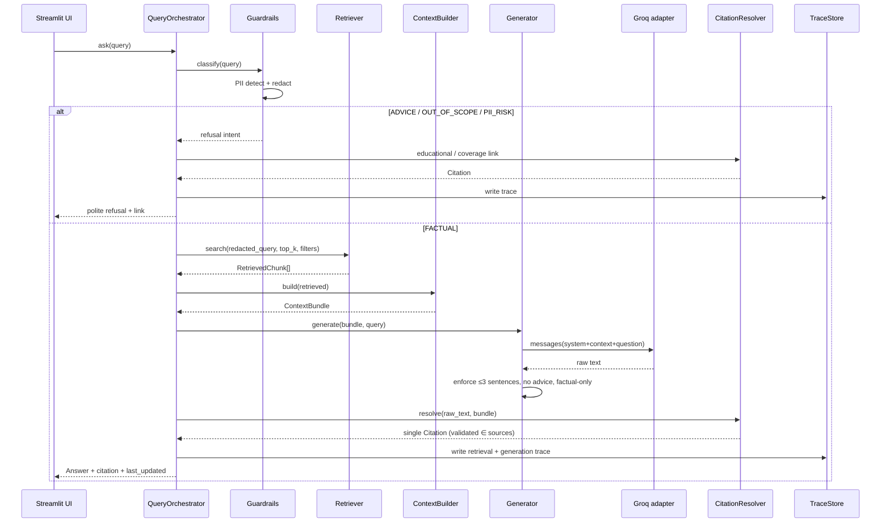
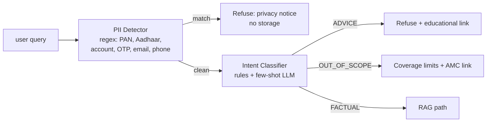
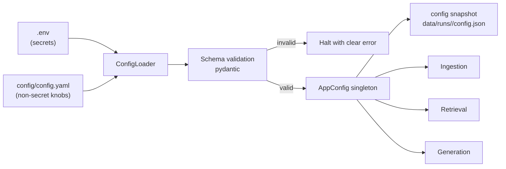
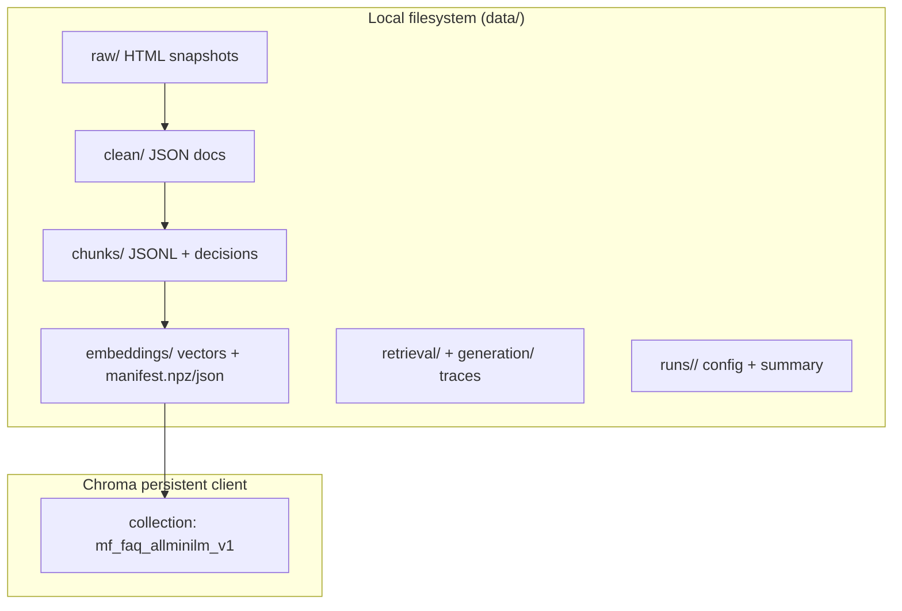

# Architecture — Groww Mutual Fund FAQ Assistant (RAG Prototype)

**Version:** 1.0
**Source:** `Docs/PRD.md` (v1.0)
**Status:** Draft
**Last Updated:** 2026-11-01

---

## 1. Purpose & Scope

This document describes the **system architecture** for the facts-only mutual fund FAQ assistant defined in `PRD.md`. It covers component decomposition, module layout, data contracts, storage layout, runtime flows, configuration, and extension points.

**Scope:** single-machine, local-first RAG prototype (Python + Streamlit) over a ~5-page corpus, with every RAG stage persisted and inspectable. Multi-tenant, auth, and HA are explicitly out of scope.

---

## 2. Architectural Principles

| Principle | Implication |
|---|---|
| **Stage transparency** | Each pipeline stage writes immutable artifacts to `data/<stage>/`; the UI reads them for the debug panel. |
| **Single source of config truth** | Ingestion and retrieval both consume the *same* validated `AppConfig`; model/DB drift is impossible by construction. |
| **Offline-first ingestion** | Scrape + chunk + embed + index are batch jobs; the chat path only reads persisted artifacts. |
| **Citation integrity** | Citations are resolved from retrieved metadata at render time, never generated by the LLM. |
| **Guardrail-first** | Every query is classified before retrieval; advice/PII/out-of-scope short-circuit the RAG path. |
| **Provider-agnostic seam** | LLM and embedding/vector stores sit behind interfaces so Groq/Gemini/OpenAI/Anthropic/Mistral and future DBs are swappable via config. |
| **Deterministic & reproducible** | Pinned versions, content hashes, config snapshots per run, reproducible chunk IDs. |

---

## 3. System Context



**Trust boundaries:**
- External web pages are untrusted input → sanitized + stored as raw snapshot before processing.
- LLM output is untrusted → validated (≤3 sentences, single citation from context, no advice) before display.
- User input is untrusted → PII-redacted and guardrail-classified before any persistence.

---

## 4. High-Level Component Architecture



### Component Responsibilities

| Component | Responsibility | Key outputs |
|---|---|---|
| **ConfigLoader** | Load + validate `config.yaml` + `.env`; expose typed `AppConfig`; assert ingest/retrieve parity | `AppConfig`, config snapshot |
| **Loader / Scraper** | Fetch 5 in-scope pages (+ SEBI/AMFI), extract main content, hash, persist raw + clean | `data/raw/`, `data/clean/` |
| **ChunkingAgent** | Inspect doc structure, choose strategy (section / recursive / table), produce chunks + rationale | `data/chunks/*.jsonl`, `chunking_decisions.json` |
| **Embedder** | Encode chunk text with `all-MiniLM-L6-v2`; persist vectors + manifest | `data/embeddings/` |
| **VectorStore (Chroma adapter)** | Upsert chunks+vectors+metadata; similarity search with optional metadata filter; rebuild | `data/chroma/`, query results |
| **Guardrails** | Classify `FACTUAL / ADVICE / OUT_OF_SCOPE / PII_RISK`; PII detect+redact | `Intent`, redaction report |
| **Retriever** | Top-k search using shared config; emit retrieval trace | `data/retrieval/<query_id>.json` |
| **ContextBuilder** | Rank/dedupe chunks, assemble context window within token budget, retain source metadata | `ContextBundle` |
| **Generator** | Build prompt from template + context; call LLM adapter; enforce constraints | `data/generation/<query_id>.json` |
| **CitationResolver** | Select **one** citation from retrieved metadata for the winning answer; validate it exists in context | `Citation` |
| **LLM adapters** | Uniform `generate(messages, params)` interface over providers | raw response |
| **TraceStore** | Append structured JSON traces per stage; redacted | `data/*/*.json` |
| **Streamlit UI** | Chat, 3 example questions, disclaimer, per-stage debug view | rendered HTML |

---

## 5. Module / Package Layout

```
rag-chatbot/
├── app/
│   └── streamlit_app.py          # Presentation layer (UI entrypoint)
├── src/
│   ├── config/
│   │   ├── loader.py             # AppConfig, validation, snapshot
│   │   └── schema.py             # dataclasses / pydantic models
│   ├── ingestion/
│   │   ├── scraper.py            # fetch + extract main content
│   │   ├── cleaner.py            # normalize text, dedupe boilerplate
│   │   └── pipeline.py           # IngestionPipeline orchestrator
│   ├── chunking/
│   │   ├── agent.py              # ChunkingAgent (strategy selection)
│   │   ├── strategies.py         # section / recursive / table splitters
│   │   └── models.py             # Chunk dataclass
│   ├── embedding/
│   │   ├── encoder.py            # SentenceTransformer wrapper
│   │   └── manifest.py           # chunk_id → vector index manifest
│   ├── vectorstore/
│   │   ├── base.py               # VectorStore ABC
│   │   └── chroma_store.py       # ChromaDB adapter
│   ├── retrieval/
│   │   ├── retriever.py          # top-k + filters
│   │   └── context_builder.py    # window assembly
│   ├── generation/
│   │   ├── prompts.py            # system + answer templates
│   │   ├── guardrails.py         # intent + PII classification
│   │   ├── generator.py          # LLM orchestration + constraints
│   │   ├── citation.py           # single-citation resolver
│   │   └── providers/            # groq.py, gemini.py, openai.py,
│   │                             # anthropic.py, mistral.py, base.py
│   ├── orchestration/
│   │   └── query_orchestrator.py # end-to-end query flow
│   ├── tracing/
│   │   └── trace_store.py        # JSON trace writer (+ redaction)
│   └── common/
│       ├── logging.py
│       └── ids.py                # deterministic query/doc/chunk ids
├── config/
│   ├── config.yaml               # non-secret knobs
│   └── prompts/                  # versioned prompt templates
├── data/
│   ├── raw/                      # raw HTML snapshots
│   ├── clean/                    # cleaned text + doc metadata
│   ├── chunks/                   # chunk JSONL + decisions
│   ├── embeddings/               # vectors + manifest
│   ├── chroma/                   # persistent Chroma collection
│   ├── retrieval/                # per-query retrieval traces
│   └── generation/               # per-query prompt/response traces
├── scripts/
│   ├── ingest.py                 # run full ingestion (phases 1-4)
│   ├── rebuild_index.py          # wipe + rebuild Chroma
│   └── evaluate.py               # sample Q&A eval (stretch)
├── tests/
├── .env                          # secrets (git-ignored)
├── requirements.txt
├── sources.md
├── sample_qa.md
└── README.md
```

---

## 6. Data Model & Contracts

### 6.1 Core Dataclasses

```python
@dataclass(frozen=True)
class DocMeta:
    doc_id: str            # hash(url)
    url: str
    scheme: str | None     # "HDFC Flexi Cap" etc.; None for AMC overview
    page_type: str         # amc_overview | scheme_fact | statement_help | factsheet
    fetched_at: datetime
    content_hash: str
    title: str

@dataclass(frozen=True)
class Chunk:
    chunk_id: str          # f"{doc_id}:{index}"
    doc_id: str
    url: str
    scheme: str | None
    section_title: str | None
    text: str
    token_count: int
    strategy: str          # section | recursive | table
    order: int

@dataclass(frozen=True)
class RetrievedChunk:
    chunk: Chunk
    score: float
    rank: int

@dataclass(frozen=True)
class ContextBundle:
    chunks: list[RetrievedChunk]
    token_estimate: int
    sources: list[str]     # de-duplicated URLs

@dataclass(frozen=True)
class Citation:
    url: str
    section_title: str | None

@dataclass(frozen=True)
class Answer:
    text: str              # ≤3 sentences
    citation: Citation | None
    last_updated: date
    intent: str
    refused: bool

@dataclass(frozen=True)
class QueryTrace:
    query_id: str
    query: str             # PII-redacted
    intent: str
    retrieved: list[dict]
    prompt: str
    model: str
    raw_response: str
    answer: Answer
    timings_ms: dict[str, int]
```

### 6.2 Stage Artifact Schemas

| Stage | Path | Format | Key fields |
|---|---|---|---|
| Raw | `data/raw/<doc_id>.html` | HTML | — (bytes) |
| Clean | `data/clean/<doc_id>.json` | JSON | `doc_id,url,scheme,page_type,fetched_at,content_hash,text` |
| Chunks | `data/chunks/<doc_id>.jsonl` | JSONL | one `Chunk` per line |
| Chunk decisions | `data/chunks/decisions.json` | JSON | `doc_id → {strategy, params, rationale}` |
| Embeddings manifest | `data/embeddings/manifest.json` | JSON | `model, dim, count, created_at, chunk_id → row_index` |
| Retrieval trace | `data/retrieval/<query_id>.json` | JSON | `query, top_k, filters, results[{chunk_id,score,url}]` |
| Generation trace | `data/generation/<query_id>.json` | JSON | `query_id, prompt, model, params, raw_response, answer, validation` |

### 6.3 Vector Store Metadata
Each Chroma record carries: `chunk_id, doc_id, url, scheme, page_type, section_title, strategy, fetched_at`. `scheme` is the primary metadata filter; `page_type` enables routing to statement-help pages.

---

## 7. Runtime Flows

### 7.1 Batch Ingestion (Phases 1–4)



**Idempotency:** skip fetch if `content_hash` unchanged; chunks/embeddings/vectors keyed by deterministic IDs → upsert is safe.

### 7.2 Query Path (Phase 5–6)



**Fail-closed behavior:** if retrieval is empty, if the LLM cites a URL not in the bundle, or if constraints fail after one retry → return a "not found in official sources" message with the AMC overview link. Never fabricate.

---

## 8. Guardrail Architecture



- **Two-layer classification:** deterministic regex/rules first (cheap, auditable), then a low-temperature LLM classification prompt for ambiguous cases. If the two disagree → treat as **ADVICE** (conservative).
- **PII:** matched fields are redacted to `[REDACTED]` *before* trace persistence and *before* the LLM call. Original query never written to disk.
- **Refusal copy:** fixed templates in `config/prompts/` (versioned), so tone is consistent and reviewable.

---

## 9. Generation & Prompt Architecture

**Prompt assembly order (system → context → question):**

1. **System prompt** (versioned): role, facts-only rules, ≤3 sentences, exactly one citation, no advice/performance claims, `Last updated from sources:` requirement, "answer only from context; if absent, say so".
2. **Context block:** numbered chunks with `[source_url | section]` headers and `fetched_at`.
3. **User question:** PII-redacted query + detected scheme (if any).

**Post-generation validation (deterministic):**
- Sentence count ≤ 3 (sentence tokenizer, ignoring the `Last updated` line).
- Citation present and **exactly one**; URL must be `∈ bundle.sources`.
- No advice/performance keywords from a blocklist.
- `Last updated from sources: <max fetched_at>` appended by the system, not the model.

On validation failure → one corrective retry with a stricter instruction; second failure → fail-closed message.

---

## 10. Configuration Architecture



- **Parity assertion (startup):** `ingestion.embedding.model == retrieval.embedding.model` and `ingestion.vector_db == retrieval.vector_db`; collection name embeds the model slug + corpus version.
- **Secrets** (`GROQ_API_KEY`, etc.) only from `.env`; never logged, never in snapshots.
- **Swappable seams** (config → implementation):

| Config key | Interface | Default impl |
|---|---|---|
| `embedding.model` | `Embedder` | `sentence-transformers/all-MiniLM-L6-v2` |
| `vector_db.type` | `VectorStore` | `chroma` |
| `chunking.strategy` | `ChunkStrategy` | `auto` (agent) |
| `llm.provider` | `LLMProvider` | `groq` |
| `llm.model` | — | from `.env` |

> The PRD's `qwen/qwen3.8-27b` is treated as a **config value**, validated at startup against the provider's model list; invalid ID → clear startup error, not a runtime crash.

---

## 11. Storage Architecture



- **Source of truth:** filesystem artifacts are canonical and human-inspectable; Chroma is a **derived index** rebuildable from `chunks/` + `embeddings/`.
- **Retention:** traces kept per run; `--clean` flag archives to `data/runs/<run_id>/` rather than deleting.
- **No PII store:** only redacted queries persist.

---

## 12. Presentation Architecture

Streamlit app with three regions:

| Region | Content |
|---|---|
| Header | Welcome line + note: **"Facts-only. No investment advice."** |
| Chat | Input box; 3 clickable example questions; answer bubbles with citation link + `Last updated from sources:` |
| **RAG Stages (tabs)** | `Cleaned Docs` · `Chunks` · `Embeddings Manifest` · `Retrieval` · `Prompt` · `Raw LLM` — read-only views over `data/` for the current query/run |

The UI is **stateless** toward the pipeline: it calls `QueryOrchestrator.ask()` and reads trace files by `query_id`. This keeps the demo panel decoupled from internals.

---

## 13. Cross-Cutting Concerns

| Concern | Approach |
|---|---|
| **Logging** | Structured JSON logs; query/doc IDs correlated; PII-redaction filter on the logging handler. |
| **Tracing/Observability** | Per-stage JSON traces + `run_id`; timings recorded in `QueryTrace.timings_ms`. |
| **Error handling** | Fail-closed at every stage; typed exceptions (`ConfigError`, `FetchError`, `EmptyRetrievalError`, `ValidationError`); user sees safe message, trace records cause. |
| **Security** | Secrets in `.env` only; HTML sanitized; no code execution from scraped content; URL allowlist for citations (official domains only). |
| **Privacy** | PII regex detection + redaction before persistence/LLM; no chat history stored beyond traces. |
| **Performance** | Precomputed embeddings; warm Chroma client in-process; target ≤8s end-to-end on CPU. |
| **Reproducibility** | Pinned requirements; deterministic IDs; config snapshot + corpus version per run. |

---

## 14. Technology Stack

| Layer | Choice | Rationale |
|---|---|---|
| Language | Python 3.10+ | Ecosystem, ML libs |
| UI | Streamlit | Fastest path to a demo UI with tabs/expander debug views |
| Scraping | `httpx` + `BeautifulSoup`/`trafilatura` | Robust main-content extraction |
| Chunking | custom strategies + `langchain-text-splitters` (optional) | Section/table-aware control |
| Embeddings | `sentence-transformers` (`all-MiniLM-L6-v2`) | PRD-mandated, CPU-friendly |
| Vector DB | `chromadb` (persistent client) | PRD-mandated, local persistence |
| LLM | Groq (`groq` SDK) default; adapters for Gemini/OpenAI/Anthropic/Mistral | PRD-mandated provider + flexibility |
| Config | `pydantic` + `PyYAML` + `python-dotenv` | Typed validation, `.env` secrets |
| Testing | `pytest` | Unit (chunking, guardrails, citation validation) + smoke e2e |

---

## 15. Non-Functional Mapping (PRD → Architecture)

| PRD requirement | Architectural mechanism |
|---|---|
| Layout: all RAG stages viewable | Per-stage artifacts + UI debug tabs (§7, §12) |
| Shared embedding/DB for ingest & retrieve | `AppConfig` parity assertion, versioned collection (§10) |
| Exactly one valid citation | `CitationResolver` + URL allowlist + context membership check (§9) |
| Refuse advice | Pre-retrieval guardrail short-circuit (§8) |
| No PII | Redaction layer before trace/LLM (§8, §13) |
| ≤3 sentences + Last updated | Deterministic post-validation (§9) |
| Config-driven swaps | Interfaces + config → impl mapping (§10) |
| ≤8s latency | Precomputed index, in-process clients, top-k=4 (§13) |
| Deliverables | `sources.md`, `sample_qa.md`, `README.md`, `data/` artifacts (§5) |

---

## 16. Extension Points (Post-MVP)

| Extension | Where it plugs in |
|---|---|
| Alternate LLM providers | Implement `LLMProvider` in `generation/providers/`; select via `llm.provider` |
| Reranking (cross-encoder) | Add stage between `Retriever` and `ContextBuilder`; flag in config |
| Other vector DBs (FAISS/pgvector) | Implement `VectorStore` ABC; set `vector_db.type` |
| More AMCs/schemes | Extend `sources.md`; re-run ingestion; optional `scheme` filter UI |
| Multi-turn memory | Add session store in orchestrator; guardrails re-run per turn |
| Online re-scrape scheduler | Wrap `scripts/ingest.py` in a cron/Task Scheduler job; hash-diff only |
| Eval harness | `scripts/evaluate.py` over `sample_qa.md`; metrics per PRD §15 |

---

## 17. Key Architectural Decisions (ADR Summary)

| # | Decision | Alternatives | Rationale |
|---|---|---|---|
| ADR-1 | Filesystem artifacts as canonical, Chroma as derived | Chroma-only | Inspectability is a hard PRD requirement |
| ADR-2 | Guardrails **before** retrieval | Post-hoc output filtering | Saves cost, avoids advice leakage in traces |
| ADR-3 | Citations resolved from metadata, not model text | Trust model output | Eliminates hallucinated links |
| ADR-4 | Single typed `AppConfig` for both paths | Separate ingest/query configs | Prevents silent embedding/DB drift |
| ADR-5 | Post-generation deterministic validation + 1 retry | LLM self-check only | Deterministic, testable compliance |
| ADR-6 | Streamlit + trace-file-backed debug panel | Custom React UI | Fastest demo, decoupled presentation |
| ADR-7 | Chunking agent logs rationale per doc | Fixed global splitter | PRD requires AI-chosen strategy, visible reasoning |

---

## 18. Open Items (mirrors PRD §16)

1. Confirm final Groq model ID (config value; startup-validated).
2. Finalize official source set (Groww + SEBI/AMFI) for the 15–25 URL list.
3. Confirm Streamlit vs Gradio.
4. Single-turn vs optional multi-turn scope.
5. Re-scrape/freshness policy and `Last updated` cutoff.
